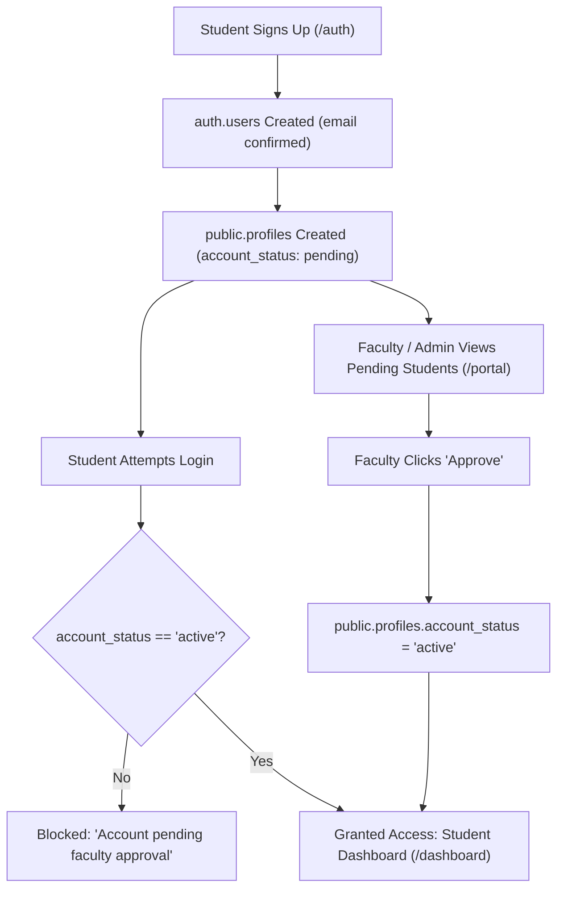

# Database Plan & Cloud Infrastructure Document

**Project:** Academic Research Repository
**Goal:** Migrate from a local database to Supabase, optimizing for performance, cost (zero-egress for large static assets), and secure access.

---

## 1. System Architecture & Data Flow

The architecture decouples heavy static assets from dynamic application data to eliminate unnecessary egress costs and improve global load times.

- **Frontend & Static Asset CDN (Vercel / Netlify):** 
  Hosts the compiled frontend code (HTML/CSS/JS) and heavy static assets like homepage background videos and branding images. This ensures fast delivery from edge nodes and zero egress fees from the database provider.
- **Supabase Authentication:** 
  Manages user identity and issues JWTs. Users authenticate to receive a JWT, which dictates their permissions across the data and storage layers.
- **Supabase PostgreSQL Database:** 
  Stores all structured relational data: user profiles, research metadata, taxonomy (categories/tags), and file references.
- **Supabase Storage:** 
  Stores academic research assets (PDF Capstones). Delivery is gated and managed by Storage RLS policies.

---

## 2. Complete Supabase DDL Schema (SQL)

The schema adheres to relational best practices: UUID primary keys, strict foreign key constraints, automated timestamp management, and separation of authentication (`auth.users`) from public application data (`public.profiles`).

```sql
-- 1. Custom Types
CREATE TYPE user_role AS ENUM ('student', 'faculty', 'admin');

-- 2. Timestamp Trigger Function
CREATE OR REPLACE FUNCTION trigger_set_timestamp()
RETURNS TRIGGER AS $$
BEGIN
  NEW.updated_at = NOW();
  RETURN NEW;
END;
$$ LANGUAGE plpgsql;

-- 3. Profiles Table (Extends auth.users)
CREATE TABLE public.profiles (
    id UUID PRIMARY KEY REFERENCES auth.users(id) ON DELETE CASCADE,
    role user_role DEFAULT 'student'::user_role NOT NULL,
    full_name TEXT NOT NULL,
    avatar_url TEXT,
    created_at TIMESTAMPTZ DEFAULT NOW() NOT NULL,
    updated_at TIMESTAMPTZ DEFAULT NOW() NOT NULL
);

-- Apply Timestamp Trigger
CREATE TRIGGER set_timestamp_profiles
BEFORE UPDATE ON public.profiles
FOR EACH ROW EXECUTE FUNCTION trigger_set_timestamp();

-- 4. Categories Table (Taxonomy)
CREATE TABLE public.categories (
    id UUID PRIMARY KEY DEFAULT gen_random_uuid(),
    name TEXT UNIQUE NOT NULL,
    description TEXT,
    created_at TIMESTAMPTZ DEFAULT NOW() NOT NULL
);

-- 5. Research Records Table (Capstones)
CREATE TABLE public.research_records (
    id UUID PRIMARY KEY DEFAULT gen_random_uuid(),
    title TEXT NOT NULL,
    abstract TEXT NOT NULL,
    keywords TEXT[] DEFAULT '{}' NOT NULL,
    pdf_path TEXT, -- Reference to the file in Supabase Storage
    author_id UUID REFERENCES public.profiles(id) ON DELETE SET NULL,
    published_date DATE,
    created_at TIMESTAMPTZ DEFAULT NOW() NOT NULL,
    updated_at TIMESTAMPTZ DEFAULT NOW() NOT NULL,
    
    -- Generated TSVector for Full-Text Search
    fts tsvector GENERATED ALWAYS AS (
        setweight(to_tsvector('english', coalesce(title, '')), 'A') ||
        setweight(to_tsvector('english', coalesce(abstract, '')), 'B')
    ) STORED
);

CREATE TRIGGER set_timestamp_research_records
BEFORE UPDATE ON public.research_records
FOR EACH ROW EXECUTE FUNCTION trigger_set_timestamp();

-- 6. Research Categories (Join Table)
CREATE TABLE public.research_categories (
    research_id UUID REFERENCES public.research_records(id) ON DELETE CASCADE,
    category_id UUID REFERENCES public.categories(id) ON DELETE CASCADE,
    PRIMARY KEY (research_id, category_id)
);
```

---

## 3. Indexing Strategy & Performance Tuning

Strategic indexes are applied to support high-frequency filtering, sorting, and full-text search requirements.

```sql
-- B-Tree Indexes for Foreign Keys and Sorting
CREATE INDEX idx_research_author ON public.research_records(author_id);
CREATE INDEX idx_research_published ON public.research_records(published_date DESC);
CREATE INDEX idx_research_created ON public.research_records(created_at DESC);

-- GIN Indexes for Arrays and Full-Text Search (FTS)
-- 1. Index for exact keyword matches within the array
CREATE INDEX idx_research_keywords ON public.research_records USING GIN (keywords);

-- 2. Index for complex linguistic text searches across Title & Abstract
CREATE INDEX idx_research_fts ON public.research_records USING GIN (fts);
```

---

## 4. Row Level Security (RLS) Rules

Security policies ensure data is only accessible to authorized individuals. **All tables must have RLS enabled.**

```sql
-- Enable RLS on all tables
ALTER TABLE public.profiles ENABLE ROW LEVEL SECURITY;
ALTER TABLE public.categories ENABLE ROW LEVEL SECURITY;
ALTER TABLE public.research_records ENABLE ROW LEVEL SECURITY;
ALTER TABLE public.research_categories ENABLE ROW LEVEL SECURITY;

-- Profiles: Anyone can view, only users can update their own
CREATE POLICY "Public profiles are viewable by everyone." 
ON public.profiles FOR SELECT USING (true);

CREATE POLICY "Users can insert their own profile." 
ON public.profiles FOR INSERT WITH CHECK ((SELECT auth.uid()) = id);

CREATE POLICY "Users can update own profile." 
ON public.profiles FOR UPDATE USING ((SELECT auth.uid()) = id);

-- Categories: Viewable by all, managed by admins (Requires admin check function/logic)
CREATE POLICY "Categories are viewable by everyone." 
ON public.categories FOR SELECT USING (true);

-- Research Records: Viewable by all, insert/update by author or admin
CREATE POLICY "Research is viewable by everyone." 
ON public.research_records FOR SELECT USING (true);

CREATE POLICY "Authors can insert own research." 
ON public.research_records FOR INSERT TO authenticated
WITH CHECK ((SELECT auth.uid()) = author_id);

CREATE POLICY "Authors can update own research." 
ON public.research_records FOR UPDATE TO authenticated
USING ((SELECT auth.uid()) = author_id)
WITH CHECK ((SELECT auth.uid()) = author_id);
```

---

## 5. Bandwidth & Caching Plan (Frontend Videos vs. Supabase PDFs)

To ensure the architecture is cost-effective and performs blazingly fast, heavy assets are routed strategically.

### A. Zero-Egress Frontend Video Strategy
Heavy visual assets like homepage background videos should **never** be stored in or served from Supabase Storage to avoid rapid egress cost inflation.
- **Placement:** Store videos in the `/public` directory of your frontend framework (e.g., Vite, Next.js).
- **Delivery:** Served directly by the frontend CDN (Vercel/Netlify).
- **Implementation:**
  ```html
  <video 
    src="/videos/homepage-bg.mp4" 
    autoplay 
    loop 
    muted 
    playsinline 
    poster="/images/homepage-poster.jpg"
    class="background-video-element"
  ></video>
  ```
- **Caching Headers (configured in `vercel.json` or `netlify.toml`):**
  Apply aggressive caching for these immutable assets: `Cache-Control: public, max-age=31536000, immutable`.

### B. Supabase Storage for Research PDFs
The actual academic capstones (PDFs) belong in Supabase Storage since they are user-generated, authenticated, and dynamic.
- **Bucket Configuration:** Create a bucket named `capstones`.
- **Cache-Control:** Set `cacheControl: '3600'` (1 hour) when uploading via the Supabase client to leverage Supabase CDN caching.
- **RLS for Storage:**
  ```sql
  -- Assuming the bucket is private but readable by authenticated users:
  CREATE POLICY "Authenticated users can read capstones" 
  ON storage.objects FOR SELECT TO authenticated
  USING (bucket_id = 'capstones');

  CREATE POLICY "Users can upload own capstones" 
  ON storage.objects FOR INSERT TO authenticated
  WITH CHECK (bucket_id = 'capstones' AND (select auth.uid()) = owner);
  ```

---

## 6. Migration Strategy from Local DB to Supabase

Migrating from a local setup to the cloud requires a staged approach to maintain data integrity.

1. **Schema Initialization:** 
   Run the provided DDL schema (Tables, Enums, Triggers, RLS, Indexes) in the Supabase SQL Editor or via the Supabase CLI (`supabase db push`).
2. **User Identity Migration:**
   Extract user credentials from the local database. Use the Supabase Management API (`POST /auth/v1/admin/users`) to bulk import users into `auth.users`, ensuring the retention of their original UUIDs so relational links aren't broken.
3. **Data Export & Transformation:**
   Export relational data (`categories`, `research_records`, `profiles`) from the local DB into CSV files. Ensure that local file paths are standardized to match the eventual Supabase Storage paths.
4. **Data Import (Bulk Insert):**
   Import the CSVs into Supabase using the Supabase Dashboard, `pgloader`, or `psql \copy` commands. **Order matters**: import `profiles` and `categories` first, then `research_records`, and finally `research_categories`.
5. **Asset Migration:**
   Write a local Node.js or Python script that reads the local PDF directory and uses the `supabase-js` Storage API to upload files to the `capstones` bucket. Update the corresponding `pdf_path` in the `research_records` table if the resulting path differs from the initial local reference.
6. **Final Validation:**
   Run parallel tests comparing local text search results with the new Supabase GIN index implementation to verify parity.

---

## 7. Supabase Auth GoTrue Null-Safety & Token Defaults

### The GoTrue Driver Issue ("Database error querying schema")
When inserting or seeding users directly into PostgreSQL's `auth.users` table via SQL (bypassing the GoTrue HTTP API), the internal Go driver (`database/sql` / `pgx`) scans database columns into non-nullable Go string fields. If any varchar or text token columns are `NULL`, GoTrue crashes on login and returns:
```
Database error querying schema
```

### Remediation & DDL Standard
All direct inserts or migrations touching `auth.users` MUST set token and change columns to empty strings (`''`) rather than `NULL`:

```sql
UPDATE auth.users
SET
  confirmation_token          = COALESCE(confirmation_token, ''),
  recovery_token              = COALESCE(recovery_token, ''),
  email_change_token_new      = COALESCE(email_change_token_new, ''),
  email_change_token_current  = COALESCE(email_change_token_current, ''),
  phone_change_token          = COALESCE(phone_change_token, ''),
  reauthentication_token      = COALESCE(reauthentication_token, ''),
  email_change                = COALESCE(email_change, ''),
  phone_change                = COALESCE(phone_change, '')
WHERE confirmation_token IS NULL
   OR recovery_token IS NULL
   OR email_change IS NULL
   OR email_change_token_new IS NULL
   OR email_change_token_current IS NULL
   OR phone_change_token IS NULL
   OR reauthentication_token IS NULL
   OR phone_change IS NULL;
```

---

## 8. Institutional Account Lifecycle & Faculty Approval Flow

CREST operates as a university departmental repository with a manual academic vetting gate for student accounts.

### Authentication Settings
- **Email Confirmations:** Disabled in the Supabase Dashboard (`Authentication -> Providers -> Email -> Confirm email = OFF`). Because the university environment relies on internal faculty vetting rather than public self-service email verification, requiring SMTP confirmations causes onboarding friction.
- **Auto-Confirm:** Newly registered students have their auth credentials created immediately, but their profile status determines access.

### Account Lifecycle Stages



1. **Registration:** Student submits the registration form with student ID, degree program (`BSIT` or `BSCpE`), year level, and section.
2. **Profile Sync:** The Supabase trigger `handle_new_user()` initializes `public.profiles` with `account_status = 'pending'`.
3. **Faculty Vetting:** Faculty members review pending submissions in the Faculty Portal (`/portal`).
4. **Activation:** Upon approval, `updateStudentStatus(id, 'active')` modifies `public.profiles`. The student is now able to authenticate and upload research capstones.
